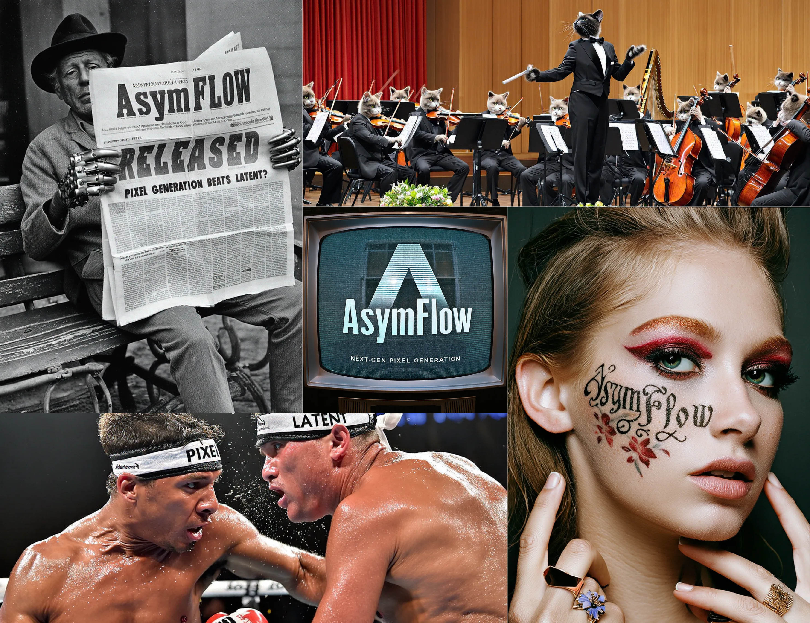

# LakonLab: Official Codebase for pi-H3, AsymFlow, pi-Flow, and GMFlow

Official PyTorch implementation of the following projects:

- Upcoming: **AnisoT2I**, **pi-Flow v2**, [**DWD**](https://hanshengchen.com/dwd/), [**AnisoFlow**](https://hanshengchen.com/anisoflow/)

- **pi-H3: Video Generation in 2–4 Steps Without a VAE Decoder [[README](docs/piH3.md)]**
    <br>
    Blog post, 2026
    <br>
    [Hansheng Chen](https://lakonik.github.io/)<sup>1*</sup>,
    [Shengqu Cai](https://primecai.github.io/)<sup>1</sup>,
    [Jiaming Song](https://tsong.me/)<sup>†</sup>,
    [Gordon Wetzstein](http://web.stanford.edu/~gordonwz/)<sup>1</sup>,
    [Xinchen Yan](https://sites.google.com/site/skywalkeryxc)<sup>†</sup>,
    [Leonidas Guibas](https://geometry.stanford.edu/?member=guibas)<sup>1</sup><br>
    <sup>1</sup>Stanford University<br>
    <sup>*</sup>Part of work done during an internship at Luma AI, <sup>†</sup>Work done while at Luma AI
    <br>
    [Blog](https://hanshengchen.com/blog/pi-h3/) | [ComfyUI](https://github.com/Lakonik/ComfyUI-piFlow) | [pi-H3 Demo🤗](https://huggingface.co/spaces/Lakonik/pi-H3)

    

- **Asymmetric Flow Models [[README](docs/AsymFlow.md)]**
    <br>
    In NeurIPS 2026
    <br>
    [Hansheng Chen](https://lakonik.github.io/),
    [Jan Ackermann](https://janackermann.info/),
    [Minseo Kim](https://soniaminseokim.github.io/),
    [Gordon Wetzstein](http://web.stanford.edu/~gordonwz/), 
    [Leonidas Guibas](https://geometry.stanford.edu/?member=guibas)<br>
    Stanford University
    <br>
    [Project Page](https://hanshengchen.com/asymflow) | [arXiv](https://arxiv.org/abs/2605.12964) | [ComfyUI](https://github.com/Lakonik/ComfyUI-piFlow) | [AsymFLUX.2 klein Demo🤗](https://huggingface.co/spaces/Lakonik/AsymFLUX.2-klein)
  
        

- **pi-Flow: Policy-Based Few-Step Generation via Imitation Distillation [[README](docs/piFlow.md)]**
    <br>
    In ICLR 2026
    <br>
    [Hansheng Chen](https://lakonik.github.io/)<sup>1</sup>, 
    [Kai Zhang](https://kai-46.github.io/website/)<sup>2</sup>,
    [Hao Tan](https://research.adobe.com/person/hao-tan/)<sup>2</sup>,
    [Leonidas Guibas](https://geometry.stanford.edu/?member=guibas)<sup>1</sup>,
    [Gordon Wetzstein](http://web.stanford.edu/~gordonwz/)<sup>1</sup>, 
    [Sai Bi](https://sai-bi.github.io/)<sup>2</sup><br>
    <sup>1</sup>Stanford University, <sup>2</sup>Adobe Research
    <br>
    [arXiv](https://arxiv.org/abs/2510.14974) | [ComfyUI](https://github.com/Lakonik/ComfyUI-piFlow) | [pi-Qwen Demo🤗](https://huggingface.co/spaces/Lakonik/pi-Qwen) | [pi-FLUX Demo🤗](https://huggingface.co/spaces/Lakonik/pi-FLUX.1) | [pi-FLUX.2 Demo🤗](https://huggingface.co/spaces/Lakonik/pi-FLUX.2)

    

- **Gaussian Mixture Flow Matching Models [[README](docs/GMFlow.md)]**
    <br>
    In ICML 2025
    <br>
    [Hansheng Chen](https://lakonik.github.io/)<sup>1</sup>, 
    [Kai Zhang](https://kai-46.github.io/website/)<sup>2</sup>,
    [Hao Tan](https://research.adobe.com/person/hao-tan/)<sup>2</sup>,
    [Zexiang Xu](https://zexiangxu.github.io/)<sup>3</sup>, 
    [Fujun Luan](https://research.adobe.com/person/fujun/)<sup>2</sup>,
    [Leonidas Guibas](https://geometry.stanford.edu/?member=guibas)<sup>1</sup>,
    [Gordon Wetzstein](http://web.stanford.edu/~gordonwz/)<sup>1</sup>, 
    [Sai Bi](https://sai-bi.github.io/)<sup>2</sup><br>
    <sup>1</sup>Stanford University, <sup>2</sup>Adobe Research, <sup>3</sup>Hillbot
    <br>
    [arXiv](https://arxiv.org/abs/2504.05304)
    
    
    <br>
    

## 🔥News

- [Nov 21, 2026] [pi-H3](docs/piH3.md) is released, the fastest MiniMax H3, with [ComfyUI](https://github.com/Lakonik/ComfyUI-piFlow) support. Try the [pi-H3 Demo🤗](https://huggingface.co/spaces/Lakonik/pi-H3).

- [May 20, 2026] AsymFlow is now supported in our [ComfyUI extension](https://github.com/Lakonik/ComfyUI-piFlow).

- [May 14, 2026] [AsymFlow](docs/AsymFlow.md) is released.

- [Dec 12, 2025] pi-FLUX.2 is now available for 4-step image generation and editing. Check out the [pi-FLUX.2 Demo🤗](https://huggingface.co/spaces/Lakonik/pi-FLUX.2). Please re-install the latest version of LakonLab (this repository) to use pi-FLUX.2.

- [Nov 7, 2025] [ComfyUI-piFlow](https://github.com/Lakonik/ComfyUI-piFlow) is now available. Supports 4-step sampling of Qwen-Image and Flux.1 dev using 8-bit models on a single consumer-grade GPU, powered by [ComfyUI](https://github.com/comfyanonymous/ComfyUI).

## Installation

The code has been tested in the following environment:

- Linux (tested on Ubuntu 20 and above)
- [PyTorch](https://pytorch.org/get-started/previous-versions/) 2.9+ (most tested on 2.10 and 2.11)

With the above prerequisites and `setuptools` installed, run `pip install -e . --no-build-isolation` from the repository root to install the LakonLab codebase and its dependencies.

An example of installation commands is shown below:

```bash
# Move to this repository (the folder with setup.py) after cloning
cd <PATH_TO_YOUR_LOCAL_REPO>

# Create uv environment (uv's managed Python includes the headers needed to build CUDA extensions)
uv venv --python 3.10 --managed-python
source .venv/bin/activate

# Install the build tool required by --no-build-isolation
uv pip install "setuptools<74"

# Install Pytorch. Goto https://pytorch.org/get-started/previous-versions/ to select the appropriate version
uv pip install torch==2.10.0 torchvision==0.25.0 --index-url https://download.pytorch.org/whl/cu128

# Install LakonLab in editable mode
uv pip install -e . --no-build-isolation
```

Additional notes:

- If `LD_LIBRARY_PATH` points to a system CUDA installation of a different version than your PyTorch build, PyTorch may load mismatched cuBLAS libraries and fail with `CUBLAS_STATUS_INVALID_VALUE`. Remove those paths from `LD_LIBRARY_PATH` in that case.

- Building CUDA extensions from source requires a CUDA toolkit with `nvcc` that supports your PyTorch build and target GPU, and a C++ compiler supported by that toolkit.

- The CUDA extensions under [lakonlab/ops](lakonlab/ops) are optional and compile on first use. The quant extension (INT8 GEMM, currently Hopper only) also needs a [CUTLASS](https://github.com/NVIDIA/cutlass) checkout at `CUTLASS_PATH`, otherwise Triton kernels are used. To prebuild the extensions at install time, set `BUILD_EXT`:

  ```bash
  CUTLASS_PATH=<PATH_TO_CUTLASS> BUILD_EXT=quant,gmflow_ops uv pip install -e . --no-build-isolation
  ```

- To use the optional [GMuon](https://github.com/Dao-AILab/gram-newton-schulz) optimizer, install LakonLab with the `gmuon` extra.

- To access FLUX models, please accept the [FLUX.2 klein Base 9B conditions](https://huggingface.co/black-forest-labs/FLUX.2-klein-base-9B) and [FLUX.1 dev conditions](https://huggingface.co/black-forest-labs/FLUX.1-dev), and then run `hf auth login` to login with your HuggingFace account.

### Sol-Attn

Install the optional `sol` extra from the repository root to enable [Sol-Attn](lakonlab/ops/sol_attn) sparse attention on supported GPUs.

```bash
uv pip install -e '.[sol]' --no-build-isolation
```

With a CUDA 13 build of PyTorch, also add `'nvidia-cutlass-dsl[cu13]'` to that command to install the CUDA 13 CuTe runtime (see the [CuTe DSL installation guide](https://docs.nvidia.com/cutlass/latest/media/docs/pythonDSL/quick_start.html#installation)).

## Codebase


**LakonLab** is a high-performance codebase for experimenting with large diffusion models. Key features of LakonLab include:
- **Performance optimizations**:
  - **Parallelism**: Seamless switching between DDP, FSDP, and FSDP2, all supporting gradient accumulation and mixed precision.
  - **Compilation**: `torch.compile` is opt-in per module (`compile_forward`), with warmup support (`bucket_warmup`) so that every shape variant is compiled up front rather than mid-run.
  - **Attention backends**: Alternative attention backends such as FlashAttention and SageAttention are supported per module via the `attention_backend_config` model setting.
  - **8-bit quantization**: Frozen linear layers can be quantized to [W8A8 types](lakonlab/ops/quant/quant.py). Supports `fp8`, `fp8_blockwise`, `int8`, `int8_smoothquant`, `int8_convrot`. Enabled via the `freeze_quant_config` model setting.
  - **Weight tying**: For LoRA fine-tuning, the base weights of the teacher, student, and EMA models are tied, sharing the same underlying memory. This is compatible with DDP and FSDP.
- **Advanced flow solvers**:
  - [**FlowSDEScheduler**](lakonlab/models/diffusions/schedulers/flow_sde.py): Generic flow SDE solver with an adjustable stochasticity parameter `h`, following<br>
    $$dx_t=\left(f_t x_t - \frac{1 + h^2}{2} g_t^2 s_t(x_t)\right) dt + h g_t d \bar w_t ,$$<br>
    where $s_t=\nabla\log p_t$, $f_t=-1/(1-t)$, and $g_t=\sqrt{2t/(1-t)}$. `h=0` gives a flow ODE, `h=1` a standard flow SDE, and `h='inf'` full re-noising.
  - [**FlowMapSDEScheduler**](lakonlab/models/diffusions/schedulers/flow_map_sde.py): Generic flow SDE solver for few-step flow map models, with the same adjustable stochasticity parameter `h`.
- **Storage backends**: Most I/O operations (e.g., dataloaders, checkpoint I/O) support both local filesystems and AWS S3. In addition, model checkpoints can be loaded from HuggingFace (link format `huggingface://<HF_REPO_NAME>/<PATH_TO_MODEL>`) and HTTP/HTTPS URLs directly.
- **Streamlined training and evaluation**: Supports online evaluation using common [metrics](lakonlab/evaluation/metrics.py), including FID, KID, IS, Precision, Recall, CLIP similarity, [VQAScore](https://github.com/linzhiqiu/t2v_metrics), [HPSv2](https://github.com/tgxs002/HPSv2), and [HPSv3](https://github.com/MizzenAI/HPSv3). Supports exporting results to offline evaluators, including [HPSv3 Benchmark](https://github.com/MizzenAI/HPSv3), [DPG-Bench](https://github.com/TencentQQGYLab/ELLA), [GenEval](https://github.com/djghosh13/geneval) and [LongText-Bench](https://github.com/X-Omni-Team/X-Omni/tree/main/textbench).
- **3rd-party model inference reproduction**:
  
  - ImageNet 256x256 models with [ADM evaluation](https://github.com/openai/guided-diffusion/tree/main/evaluations):

    | Model                                                             | FID (reproduced) | FID (official) |
    |-------------------------------------------------------------------|:----------------:|:--------------:|
    | [SiT-XL/2](configs/misc/sit_imagenet_test.py)                     |       2.05       |      2.06      |
    | [JiT-H/16](configs/misc/jit_h_16_imagenet_test.py)                |       1.90       |       -        |
    | [DiT-XL RAE (unguided)](configs/misc/rae_dinov2_imagenet_test.py) |       1.50       |      1.51      |
    | [REPA-XL/2](configs/misc/repa_imagenet_test.py)                   |       1.38       |      1.42      |
    | [REPA-E-XL VAVAE](configs/misc/repae_imagenet_test.py)            |       1.12       |      1.12      |

    Note: <br>
    We use BF16 inference for all models except RAE. <br>
    Original JiT paper uses its own evaluation protocol that differs from ADM evaluation.

  - Text-to-image models:

    See examples in [configs/misc](configs/misc) and [lakonlab/models/architectures/diffusers](lakonlab/models/architectures/diffusers).

LakonLab uses the configuration system and code structure from [MMCV](https://github.com/open-mmlab/mmcv).

## Acknowledgments

- **Sol-Attn**: vendored and adapted from [NVIDIA Sol-Engine](https://github.com/NVlabs/Sana/tree/781e8341fb3b29d3aea5d50265772e9619340b66/models/minimax_h3/Sol-H3/h3_runtime/third_party/sol_attn) ([license and credits](lakonlab/ops/sol_attn/THIRD_PARTY_NOTICES.md)).

## Citation
```
@misc{chen2026pih3,
  title        = {{pi-H3: Video Generation in 2–4 Steps Without a VAE Decoder}},
  author       = {Hansheng Chen and Shengqu Cai and Jiaming Song and Gordon Wetzstein and Xinchen Yan and Leonidas Guibas},
  year         = {2026},
  month        = nov,
  howpublished = {\url{https://hanshengchen.com/blog/pi-h3/}}
}

@article{chen2026decoding,
  title={Decoding Without a Decoder: Direct Pixel Prediction from Diffusion Transformers},
  author={Hansheng Chen and Shengqu Cai and Jan Ackermann and Rayhan Zirvi and Gordon Wetzstein and Xinchen Yan and Leonidas Guibas},
  journal={arXiv preprint arXiv:2611.22287},
  url={https://arxiv.org/abs/2611.22287},
  year={2026},
}

@article{asymflow,
  title={Asymmetric Flow Models},
  author={Hansheng Chen and Jan Ackermann and Minseo Kim and Gordon Wetzstein and Leonidas Guibas},
  url={https://arxiv.org/abs/2605.12964},
  journal={arXiv preprint arXiv:2605.12964},
  year={2026},
}

@article{piflow,
  title={pi-Flow: Policy-Based Few-Step Generation via Imitation Distillation}, 
  author={Hansheng Chen and Kai Zhang and Hao Tan and Leonidas Guibas and Gordon Wetzstein and Sai Bi},
  url={https://arxiv.org/abs/2510.14974}, 
  journal={arXiv preprint arXiv:2510.14974},
  year={2025},
}

@article{gmflow,
  title={Gaussian Mixture Flow Matching Models},
  author={Hansheng Chen and Kai Zhang and Hao Tan and Zexiang Xu and Fujun Luan and Leonidas Guibas and Gordon Wetzstein and Sai Bi},
  url={https://arxiv.org/abs/2504.05304}, 
  journal={arXiv preprint arXiv:2504.05304},
  year={2025},
}
```
